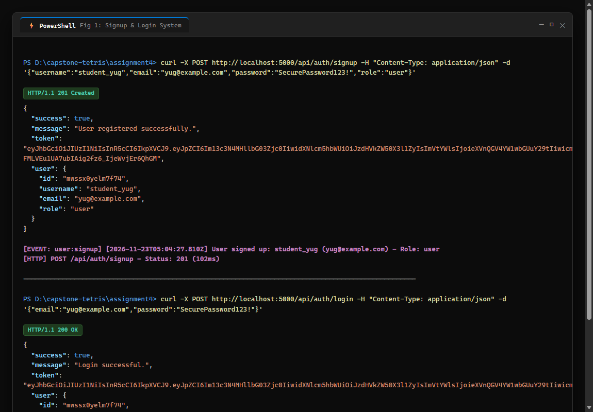
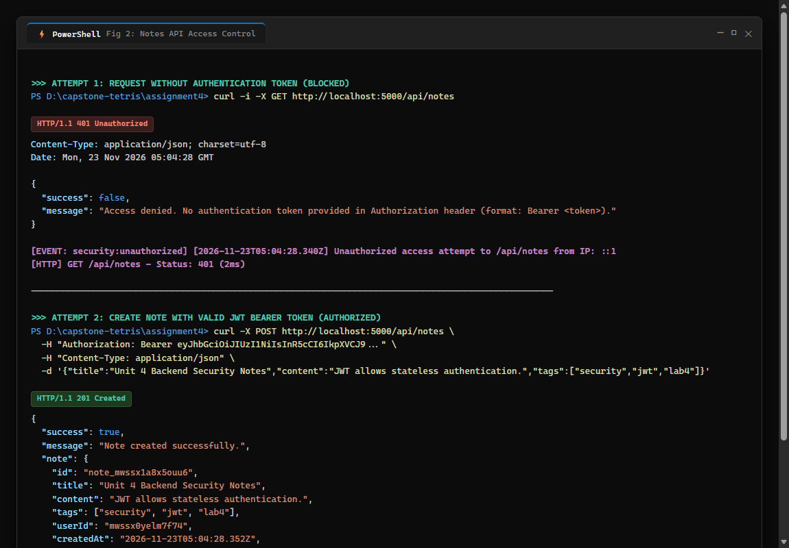
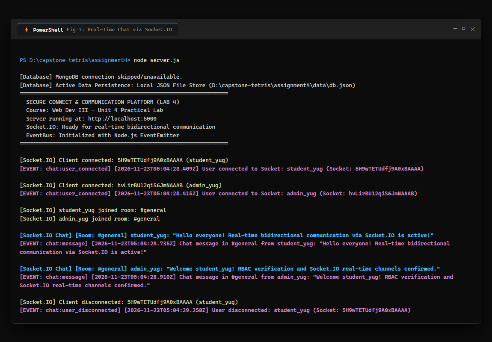
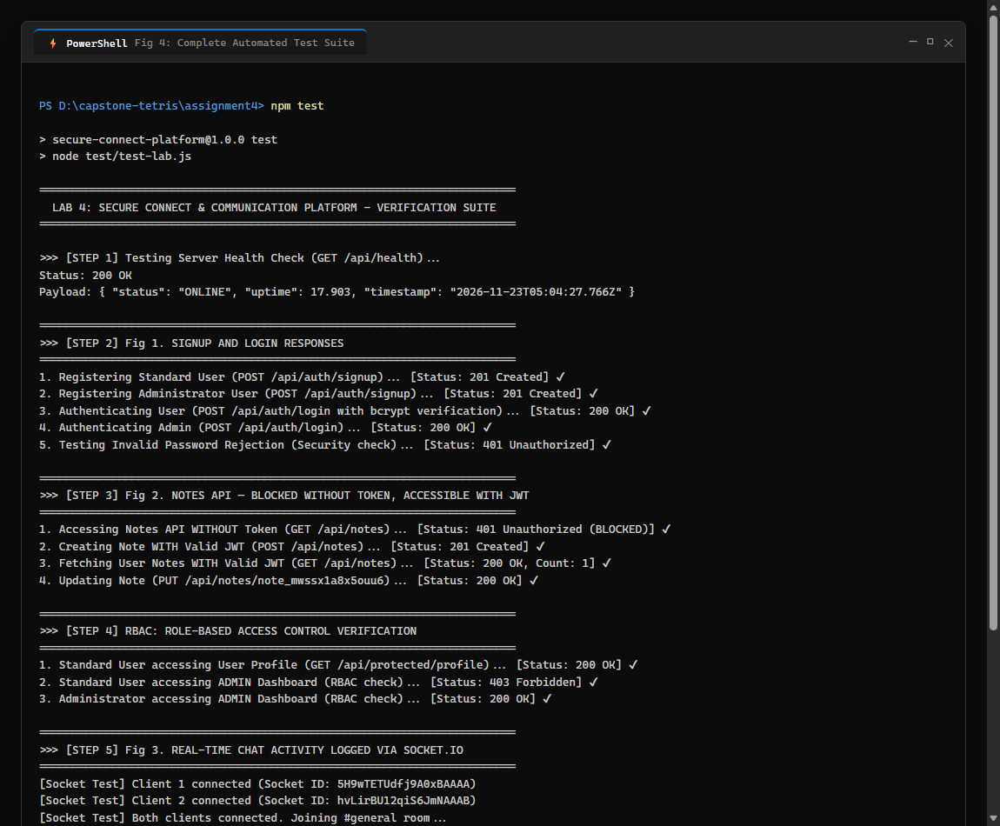
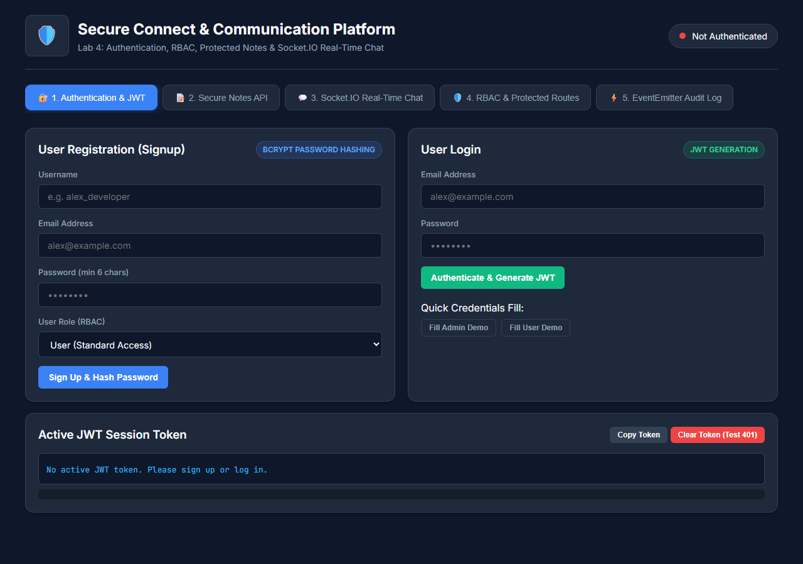
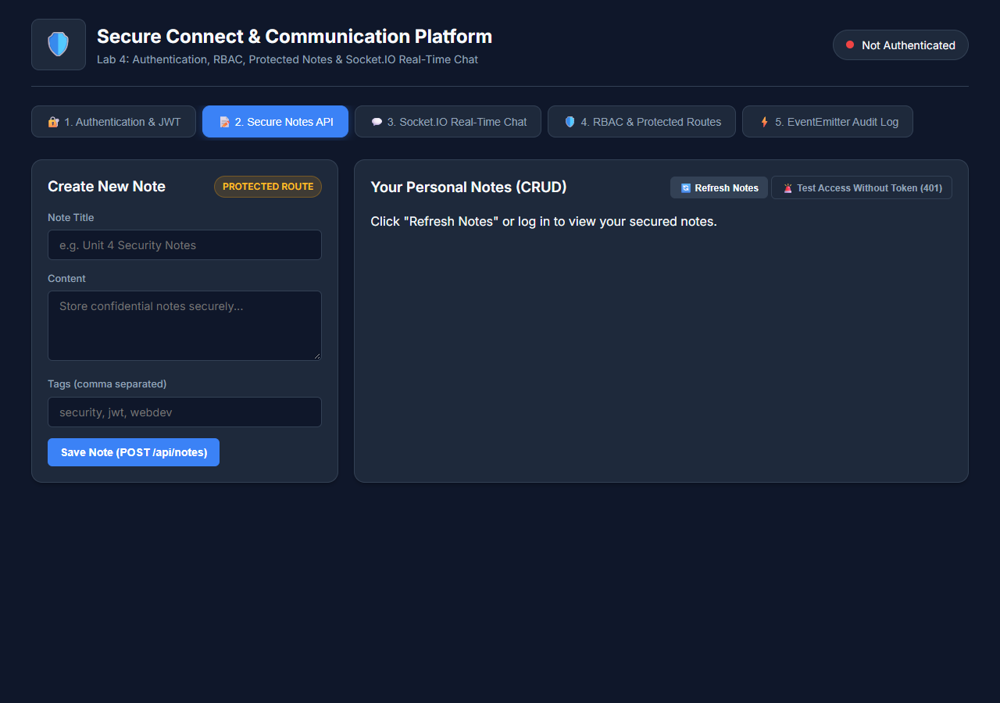

# Lab 4: Secure Connect and Communication Platform

**Course:** Web Dev III  
**Unit Covered:** Unit – 4  
**Student:** Yug Verma  
**Mode:** 100% In-Class (Lab Practicals)  

---

## 📌 Project Overview
The **Secure Connect and Communication Platform** is a secure, production-ready server-side application built with **Node.js, Express, JWT, bcrypt, Socket.IO, and EventEmitter**. It implements robust authentication, role-based access control (RBAC), protected CRUD notes management, and real-time bidirectional communication.

### ✨ Key Features & Learning Objectives Met
1. **Signup & Login System**:
   - Secure password hashing and verification using `bcryptjs` (salt rounds: 10).
   - Duplicate user and email detection with input validation.
2. **Stateless JWT Authentication**:
   - Generates signed JSON Web Tokens containing user identity and role.
   - Verifies tokens using `authMiddleware` on protected API endpoints.
3. **Role-Based Access Control (RBAC)**:
   - Dynamic `authorizeRoles('admin', ...)` middleware restricting critical resources.
   - Verified rejection (HTTP 403) for non-admin users attempting privileged access.
4. **Secure Notes API (Full CRUD)**:
   - `POST /api/notes`: Create private notes tied to authenticated user ID.
   - `GET /api/notes`: Read only user's personal notes.
   - `GET /api/notes/:id`: Ownership-verified single note lookup.
   - `PUT /api/notes/:id`: Ownership-verified note updates.
   - `DELETE /api/notes/:id`: Ownership-verified note deletion.
   - Blocked with `401 Unauthorized` without a valid token.
5. **Real-Time Bidirectional Communication (Socket.IO)**:
   - Handshake authentication and active user presence tracking.
   - Room-based chat channels (`#general`, `#developers`, `#security-ops`).
   - Real-time message broadcasting and typing status events.
   - Activity logging directly on the server console.
6. **Node.js EventEmitter (Event-Driven Architecture)**:
   - System-wide `eventBus` emitting and auditing:
     - `user:signup`, `user:login`, `user:login_failed`
     - `note:created`, `note:updated`, `note:deleted`
     - `chat:message`, `chat:user_connected`, `chat:user_disconnected`
     - `security:unauthorized`, `security:forbidden_role`
7. **Zero-Configuration Dual Data Persistence**:
   - Automatically detects and connects to MongoDB if available.
   - Seamlessly falls back to an internal persistent JSON file store (`data/db.json`) if MongoDB is not running, ensuring 100% out-of-the-box functionality without crashes.
8. **Interactive Web Dashboard**:
   - Built-in full-featured web client served at `http://localhost:5000` for live browser demonstration.

---

## 🛠️ Technology Stack
- **Runtime:** Node.js (v18+)
- **Framework:** Express.js
- **Authentication:** `jsonwebtoken` (JWT)
- **Hashing:** `bcryptjs`
- **Real-Time:** `socket.io` & `socket.io-client`
- **Events:** Node.js native `EventEmitter`
- **Environment Management:** `dotenv`
- **Data Persistence:** MongoDB via `mongoose` / Fallback JSON Store

---

## 🚀 Getting Started

### 1. Installation
```bash
git clone https://github.com/yugggfr/assignment4.git
cd assignment4
npm install
```

### 2. Environment Configuration
Create or inspect `.env`:
```env
PORT=5000
NODE_ENV=development
JWT_SECRET=super_secret_jwt_key_lab4_secure_connect_platform_2026
JWT_EXPIRES_IN=24h
MONGO_URI=mongodb://localhost:27017/secure_connect_db
```

### 3. Start the Server
```bash
npm start
```
The server will start at: `http://localhost:5000`

### 4. Run Automated Test Suite
To verify all criteria automatically in the terminal:
```bash
npm test
```

---

## 📸 Output & Genuine Screenshots

Genuine screenshots of the terminal and running application are stored in the [`screenshots/`](./screenshots/) folder:

| Figure | Description | File |
| :--- | :--- | :--- |
| **Fig 1** | Signup & Login Responses (bcrypt hashing & JWT generation) | [`screenshots/fig1_signup_login_response.png`](./screenshots/fig1_signup_login_response.png) |
| **Fig 2** | Notes API: Blocked without token (401), accessible with JWT (201/200) | [`screenshots/fig2_notes_api_protection.png`](./screenshots/fig2_notes_api_protection.png) |
| **Fig 3** | Socket.IO Real-time Chat Activity & Event Logging | [`screenshots/fig3_realtime_chat_activity.png`](./screenshots/fig3_realtime_chat_activity.png) |
| **Fig 4** | Complete Test Suite Execution in Terminal | [`screenshots/fig4_test_suite_execution.png`](./screenshots/fig4_test_suite_execution.png) |
| **Fig 5** | Web Dashboard Interface (Auth Tab) | [`screenshots/fig5_web_dashboard.png`](./screenshots/fig5_web_dashboard.png) |
| **Fig 6** | Web Dashboard Interface (Protected Notes Tab) | [`screenshots/fig6_notes_dashboard.png`](./screenshots/fig6_notes_dashboard.png) |

---

### Fig 1. Signup and Login Responses (Terminal / API Console)


### Fig 2. Notes API — Blocked Without a Token, Accessible With a Valid JWT


### Fig 3. Real-Time Chat Activity Logged via Socket.IO


### Fig 4. Automated Verification Suite Execution


### Fig 5. Web Dashboard (Interactive Frontend Client)


### Fig 6. Secured Notes Management Dashboard



---

## 📡 API Reference Summary

### Authentication Endpoints
- `POST /api/auth/signup` - Register a new user
- `POST /api/auth/login` - Authenticate & obtain JWT
- `GET /api/auth/me` - Protected: Get current user profile

### Notes Endpoints (All require `Authorization: Bearer <token>`)
- `POST /api/notes` - Create a note
- `GET /api/notes` - Retrieve all notes for logged-in user
- `GET /api/notes/:id` - Retrieve a specific note
- `PUT /api/notes/:id` - Update a note
- `DELETE /api/notes/:id` - Delete a note

### Protected & RBAC Endpoints
- `GET /api/protected/profile` - Accessible to any authenticated user
- `GET /api/protected/admin-dashboard` - Restricted to `admin` role (RBAC)
- `GET /api/protected/events` - Retrieve EventEmitter audit history

---

## 🧪 Postman Collection
Import [`postman_collection.json`](./postman_collection.json) directly into Postman to test all routes interactively.
